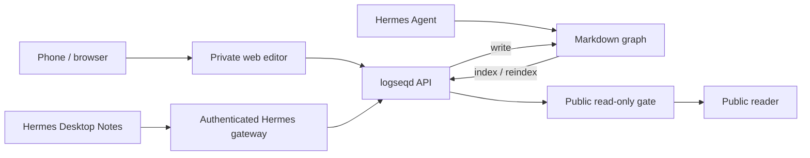

# Mnemosyne

**Capture, connect, discuss, and publish—with your agent.**

Capture a thought on your phone, develop it in a conversation, keep the result
in your knowledge graph, and publish selected pages. Your notes live in ordinary
Markdown files using Logseq's block, page-reference, and journal conventions.

The project brings together a private web editor, a public reader, a queryable
graph API, and a Hermes Desktop plugin. It is an independent community project.
The web editor works without either desktop application installed.

[Desktop plugin](docs/hermes-desktop.md) · [Run the web stack](docs/deployment.md) · [Development checks](tests/README.md) · [MIT license](LICENSE)

## The workflow

1. **Capture.** Open your journal and start writing. Expand the composer for a
   longer entry; the same draft stays with you.
2. **Connect.** Organize thoughts into blocks and sub-blocks, link pages with
   `[[references]]`, and explore your notes through the library and graph views.
3. **Discuss.** Hover any block in Hermes Desktop and choose **Discuss with Hermes**.
   It opens a fresh chat with that block's saved reference as a composer chip.
   Type your question; nothing is sent automatically.
4. **Keep.** Your agent can read and write the same graph through files or the
   API. Research, journal entries, and scheduled reports become durable notes.
5. **Publish.** Mark a page public to make it available through the read-only
   reader. The private editor and public site use separate API surfaces.

## What is available

| Interface | What it does | Current status |
|---|---|---|
| **Private web editor** | Journals, expandable capture, block editing, page references, search, library, and graph browsing | Used in the maintainer's deployment; actively improving |
| **Hermes Desktop plugin** | Notes workspace and side pane, journal capture, page browsing/search, block editing, native context references, and edit suggestion review | Implemented and tested with an SDK browser harness and real backend; native Desktop/VPS acceptance remains |
| **Public reader** | Read-only pages, search, curated ordering, and dated series | Used in the maintainer's deployment; deployment still contains personal configuration |
| **Graph API — logseqd** | Read/write operations, incremental indexing, properties, and Datalog queries | Included as a pinned submodule |
| **Agent skills** | Graph conventions, publishing helpers, deployment notes, and scheduled workflow examples | Adapt to your graph and installed agent version |

The web interfaces are plain HTML, CSS, and JavaScript with no frontend build
step. The Desktop plugin uses Hermes's React and plugin SDK. Development tests
have their own dependencies.

Example public reader: [notes.mxjxn.com](https://notes.mxjxn.com).

## How the pieces fit



Your server holds the main graph in the current workflow. Browser edits,
Desktop edits, Telegram conversations, and scheduled agent work can all use that
same graph. Logseq Desktop is optional; it is not required for this workflow.

**Git history is a separate layer.** The maintainer's deployment automates commits
and pushes. This repository includes a watcher that pulls remote changes, but
it does not provide a complete automatic commit/push service for every install.

## Get started

Clone the repository with its pinned backend:

```sh
git clone --recurse-submodules https://github.com/mxjxn/Mnemosyne.git
cd Mnemosyne
```

Choose the part you want to use:

- **Already running a graph on a server?** Follow the [Hermes Desktop guide](docs/hermes-desktop.md)
  to add the Notes workspace and companion pane. Install the backend on the
  server and the Desktop half on your computer.
- **Setting up the web editor or public reader?** Use the [manual deployment guide](docs/deployment.md).
  It covers the Clojure backend, `/api` routing, file watching, and publishing.
- **Developing the integration?** Start with the [test guide](tests/README.md).

`setup.sh` is a legacy installer and is **not the recommended setup path**. Its
backend launch command and some copied paths do not match the current tree.
The manual guide uses the checked-in Clojure entry point.

## Files and compatibility

A graph is a directory containing `pages/` and `journals/`:

```text
my-graph/
├── pages/
│   └── Project Notes.md
└── journals/
    └── 2026_10_27.md
```

A page uses Logseq-style properties and tab-indented blocks:

```markdown
title:: Project Notes
- An idea worth keeping
	- A supporting detail
- A connection to [[Another Page]]
```

`logseqd` runs on the JVM using Clojure CLI, DataScript, and Ring/Jetty. The
repository's current backend does not include a Babashka launcher. Its parser
supports the file conventions used here; it does not implement every Logseq
feature or the separate Logseq database format.

Properties are queryable through `/property` and Datalog. Search currently
excludes journals, several date/system-page patterns, and pages marked
`private:: true`; it should not be described as a search of every block.

## Publishing rules

The checked-in public gate exposes a page when either page property is present:

```markdown
public:: true
```

or:

```markdown
visibility:: public
```

Publication applies to the **whole page**, including its blocks. `position:: N`
controls curated ordering after publication; adding or removing `position` does
not publish or unpublish a page. `private:: true` is not an override for the
public gate's allowlist.

To unpublish, remove both public markers if present, reindex the file, and allow
the gate's 15-second allowlist cache to expire. See [public reader setup](docs/deployment.md#public-reader)
for routing, graph-path configuration, and a verification example. The reader
renders external HTTPS images; it does not expose the graph's local asset folder.

## Repository map

| Path | Role |
|---|---|
| [`viewer/`](viewer/) | Private browser editor and PWA |
| [`reader/`](reader/) | Public read-only frontend |
| [`gate/gate.mjs`](gate/gate.mjs) | Public page allowlist and read-only API |
| [`logseqd/`](logseqd/) | Pinned graph API submodule |
| [`desktop/plugin.js`](desktop/plugin.js) | Native Hermes Desktop interface |
| [`dashboard/plugin_api.py`](dashboard/plugin_api.py) | Authenticated gateway bridge to logseqd |
| [`skills/`](skills/) | Agent integration and workflow examples |
| [`scripts/`](scripts/) | File reindexing and optional Git-pull watchers |
| [`docs/`](docs/) | Desktop and web deployment guides |
| [`tests/`](tests/) | Plugin checks and integration tests |

## Project status and contributions

This is a production-derived alpha, built around one person's daily workflow.
The web stack is in use; a clean installation on a new machine is not yet
validated end to end. Linux is the reference server environment. The included
watcher uses Linux `inotifywait`; a native macOS watcher is not implemented.

The Desktop plugin has automated checks, but those do not replace acceptance in
a real native Desktop/VPS session. Local graph replication and conflict-safe
multi-device file sync are outside the current implementation. Web capture has
local draft/queue support and some cached reads; this is not a fully offline
notes system.

Useful contributions include reproducible installation reports, writing and
navigation improvements, publishing checks, and watcher portability. For an
issue, include the interface you used, the relevant version or commit, and the
steps that reproduce the behavior. Use a disposable graph for write tests.

## License

This repository's code and documentation are available under the [MIT license](LICENSE).
The separately maintained `logseqd` submodule retains its [CC0 license](logseqd/LICENSE).
